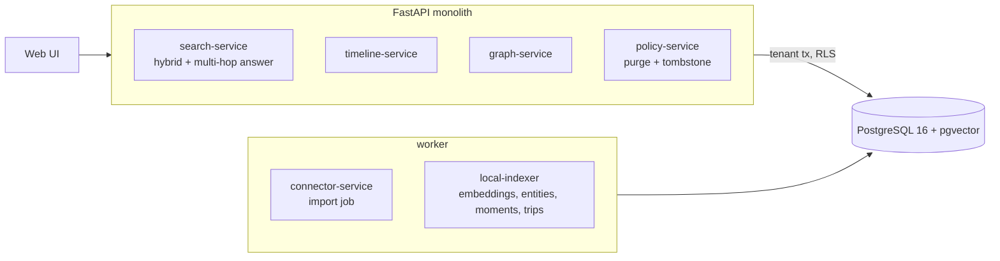

# Personal Digital Memory & Life Search Engine

Search across one person's photos, receipts, e-mail, calendar and messages, and answer questions that no single record holds:
*"Find the Italian restaurant from my 2024 Chicago trip where I photographed a red motorcycle, then show the receipt and who I was with."*
Every answer shows the hops it took and the records each hop rests on. Indexing is local: no outside model or service is called.

Built from blueprint 2 of "Advanced Project Blueprints, Volume II" as a **vertical slice**: the demo scenario end to end, with the
platform parts real and the rest listed under [Not built](#not-built-and-why).

**The person, their contacts and every record are generated. There are no image files: a "photo" is the time, GPS and tags an on-device tagger would produce.**

## Run it

```bash
docker compose up --build        # migrates, seeds, serves http://localhost:8202/ui/ with one worker
docker compose run --rm test     # 29 tests against a throwaway database
```

Open http://localhost:8202/ui/ and press **Run all steps**, or `make bootstrap demo`. API docs at `/docs`.
Demo tokens (local only): `maya-owner-demo`, `maya-reader-demo`. Run `make reset` before running the demo a second time.

## The demo, step by step

1. Import three years of exports from six apps: 2,549 records (1,426 photos, 432 e-mails, 289 receipts, 203 messages, 185 calendar entries, 14 contacts).
2. The indexer finds 12 trips away from home and 1,032 separate moments from timestamps, GPS and receipt addresses; recovers 161 restaurants from scanned receipts; links 2,849 mentions to people, places and cities, and leaves 13 unlinked because a first name fits two contacts.
3. The question is answered in five hops: the 2024 Chicago trip, the red-motorcycle photo inside it, the moment that photo belongs to, the receipt in that moment, the people named in its calendar entry: *Osteria Bellavita, 20 March 2024, $153.60, with Lucas Moreau.* Plain vector search for the same sentence returns five photos of bicycles and motorcycles from other trips.
4. The receipt as scanned, with what was found in it, and everything connected to the person who was there.
5. A four-sentence summary of the trip, each sentence listing its source records.
6. The owner purges the receipt. Zero derived rows remain, and the same question now answers "No receipt for that meal is in the archive." A question about a 2019 Boston trip is declined: no such trip.
7. The audit log: the purge entry holds the record type and a fingerprint, never content.

## Architecture



| Piece | How it works |
|---|---|
| Embeddings | Latent semantic analysis fitted on the owner's own archive: character n-gram TF-IDF reduced to 128 dimensions, stored in pgvector with an HNSW index. Character n-grams put "motorbike" near "motorcycle" with no outside model. |
| Moments and trips | A moment is a run of records with no two-hour silence and no 600 m jump; a calendar entry counts for its whole length. A trip is a run of days whose located records are in one city away from home. |
| Restaurants | From receipts. The merchant line is folded (`BELLAV1TA` to `BELLAVITA`) so scanner errors collapse to one place; cuisine is a vote over a small dish lexicon. |
| People | E-mail addresses and full names link with certainty. A bare first name links only if one contact fits, or if the same moment's calendar entry settles it; otherwise it is left unlinked. |
| Multi-hop answer | Rules parse the year, city, cuisine and photographed object out of the question. Then: trip, photo (vector search inside the trip's dates), the moment containing it, receipt, people. A hop that finds nothing ends the chain with the reason. No language model. |
| Search | Vector similarity and Postgres full-text rank fused by reciprocal rank, with optional kind filters. |
| Purge | Deletes the record; embedding, mentions and event links cascade. A tombstone of the checksum stops the next import from bringing it back. |
| Platform | Row-level security per archive, Postgres job queue, idempotent import, hash-chained audit log, `/metrics`. |

## Data model

`migrations/002_memory.sql` follows the blueprint (artifacts, entities, mentions, events, event_artifacts, embeddings); additions are
marked `(+)`. The blueprint's `owner_id` is `tenant_id`: one tenant is one person's archive. Vectors are 128-dimensional, not 1536.

## API

| Method | Endpoint | Purpose |
|---|---|---|
| POST | `/v1/connectors/import` | 202 + job: import an export and index it |
| POST | `/v1/search` | Hybrid search, plus the step-by-step answer when the question allows one |
| GET | `/v1/timeline?from=&to=&level=` | Trips or moments with place, people and record counts |
| GET | `/v1/entities/{id}/graph` | A person, place or city and what it is connected to |
| POST | `/v1/memories/summarize` | Extractive summary of a trip or moment, sources per sentence |
| DELETE | `/v1/artifacts/{id}?purge=true` | Purge a record and everything derived from it |
| GET | `/v1/artifacts/{id}` · `/v1/entities` | (+) A source record; entity lookup |

Contract: [`docs/openapi.json`](docs/openapi.json).

## Measured

[`docs/evaluation.md`](docs/evaluation.md) (`python -m mem.evaluate`, six archives the demo never uses, 291 questions) and [`docs/performance.md`](docs/performance.md).

| Component | Result | Baseline |
|---|---|---|
| Multi-hop questions: right restaurant | 93.8% | |
| Multi-hop questions: right receipt | 92.8% | plain vector search, top 1: 8.9% (top 5: 33.3%) |
| Everyone present named, nobody extra | 79.4% (precision 0.997, recall 0.811) | |
| Grouping records into moments (pairwise F1) | 0.905 | same calendar day: 0.699 |
| Linking people (precision / recall) | 1.000 / 0.971 | guessing an ambiguous first name: 0.985 / 0.985 |

The generated archives are far tidier than a real one, and the cuisine lexicon is the one the generator draws from (so cuisine is
100%). What carries over is the comparison: a question with several constraints needs the structure, not a better embedding.

## The hardest tradeoff

Guessing versus declining. Two contacts are both called Alex, and a message arrives from "Alex". Guessing the first Alex gives the
same F1 as refusing (0.985 either way) but turns certain errors into the answer to "who was I with": precision falls from 1.000 to
0.985. In a memory product a confident wrong name is worse than a gap, so ambiguous names are left unlinked, and the whole chain
works the same way: it declined 10 of 291 questions rather than return the nearest thing. The cost is recall: 19% of the people
actually present go unnamed, mostly at dinners with no calendar entry. The answer shows what it rests on so the gap is visible.

## Threat model (summary)

| Threat | Mitigation here | Gap |
|---|---|---|
| One person's archive visible to another | Row-level security on every table including vectors; tested with a second archive that plants the same demo data | |
| Private content leaving the machine | No outside call anywhere: embeddings, parsing and summaries are local | Content is not encrypted at rest beyond the database's own storage |
| A deleted record surviving in derived data | Cascading deletes for vector, mentions and event links; tested that zero rows remain; tombstone blocks re-import | Database backups are out of scope |
| Sensitive content leaking into logs | Audit entries carry type and checksum prefix only (tested); request logs carry no bodies | |
| Injection through the search box | Query text is only ever a bound parameter; full-text terms are reduced to letters and digits | |
| Invented answers | Extractive only; every sentence and hop lists its sources; sentences without sources are dropped | |

## Not built, and why

- **Real connectors** (Google Photos, Gmail, iCloud, WhatsApp): one deterministic synthetic export stands in.
- **Images, OCR and audio**: no image is ever read. Photo tags and receipt text arrive as if a tagger and a scanner had already run. No face clustering.
- **Neural embeddings**: LSA is a deliberate local stand-in; a multimodal model would replace `engine.embedder` without changing the chain.
- **A language model** for answers or summaries: answers are templated from the records found.
- **Learning from clicks, encrypted cloud sync, time zones** (all times are treated as one clock): not started.
- **Kafka, Redis, OpenTelemetry, Grafana, MLflow, Terraform, CI, SSO, a Next.js front end**: not needed to prove the slice; no cloud account used.

## Commercial sketch

Buyer: individuals, researchers, journalists, family archives. Pricing shape from the blueprint: a free local tier, paid encrypted
sync, a family plan, a professional tier, storage add-ons.

## Layout

```
core/        platform kit: db + RLS, jobs, audit chain, HTTP, scenario runner, load test
mem/         world (synthetic archive), engine (embeddings, moments, trips, places, people, question parser), api, seed, evaluate
migrations/  forward-only SQL          web/   UI, scenario.json, demo.json (recorded run)
tests/       29 tests                  docs/  evaluation.md, performance.md, openapi.json
```
